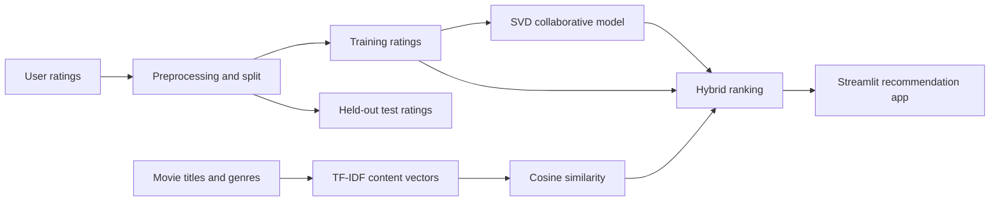

# Movie Recommendation System

**Personalized movie discovery with collaborative filtering, content similarity, and hybrid ranking**

Project presentation | Suggested length: 7-10 minutes

---

## Slide 1 - The project

### Movie Recommendation System

A personalized movie discovery app built with the MovieLens 1M dataset.

- Recommend unseen movies from a user's rating history
- Combine collaborative and content-based signals
- Present recommendations and score explanations in a Streamlit app

**Speaker notes:** Introduce the goal: help a viewer narrow a large movie catalog to a useful, personalized shortlist.

---

## Slide 2 - The problem and objective

### From ratings to useful picks

Movie catalogs are large, and a user's past ratings provide only an incomplete picture of what they may enjoy next.

**Objective:** use a MovieLens user profile and movie information to rank movies the user has not rated.

The project combines two complementary signals:

- Patterns in ratings from users with similar behavior
- Similarity between a candidate movie and movies the user has rated

**Speaker notes:** Collaborative filtering can discover broader taste patterns; content similarity can keep recommendations related to the user's own history.

---

## Slide 3 - Data and pipeline

### MovieLens 1M

- 1,000,209 ratings
- 6,040 users
- 3,883 movies
- Training set: 800,167 ratings
- Test set: 200,042 ratings

**Speaker notes:** The test set is held out for rating-prediction evaluation. Movie titles and genres supply the content representation.

---

## Slide 4 - Two recommendation signals

### Collaborative filtering

The SVD model estimates how a user may rate a movie by learning patterns from the training ratings.

### Content-based similarity

Movie text is represented with TF-IDF. Cosine similarity compares candidate movies with the movies already rated by the selected user.

### Why use both?

The signals contribute different evidence: learned rating patterns and similarity to an individual user's history.

**Speaker notes:** Neither signal is a complete description of taste. The hybrid ranker brings them together rather than relying on only one source.

---

## Slide 5 - Hybrid ranking

### How a candidate is scored

1. Remove movies the user has already rated.
2. Estimate the user's rating with SVD.
3. Normalize the SVD estimate: `(predicted rating - 1) / 4`.
4. Find the candidate's strongest content similarity to a rated movie.
5. Combine both signals equally and sort by the result.

**Hybrid score** = `0.5 x normalized SVD score + 0.5 x content similarity`

The hybrid score is a ranking signal, not a probability that the user will like a movie.

**Speaker notes:** The app can optionally limit candidates to selected genres. That filter narrows the candidate set; it does not change the model weights.

---

## Slide 6 - Product walkthrough

### Framefinder

- Enter a MovieLens user ID
- Choose 5, 10, 15, or 20 recommendations
- Optionally limit results to selected genres
- Review profile rating count and average rating
- Expand a movie to compare its predicted-preference and content-similarity scores
- Export the results as CSV

The results view includes two charts:

- Rated-movie counts by genre for the selected profile
- Collaborative and content scores for the top recommendations

**Speaker notes:** The genre chart summarizes what the profile has rated, not a definitive preference or sentiment label. The score chart exposes the two inputs behind each hybrid ranking.

---

## Slide 7 - Evaluation

### Rating-prediction results

| Metric | Result | Interpretation |
| --- | ---: | --- |
| RMSE | 0.8784 | Root mean squared error on the 1-5 rating scale |
| MAE | 0.6902 | Mean absolute error on the 1-5 rating scale |

These metrics compare predicted ratings with held-out ratings. Lower values indicate smaller rating-prediction errors.

**Important context:** RMSE and MAE do not by themselves measure whether the top-ranked movies are useful. Ranking-focused evaluation such as Precision@K or NDCG would add evidence about recommendation quality.

**Speaker notes:** Present these as rating-prediction metrics, not as proof of user satisfaction or top-N ranking performance.

---

## Slide 8 - Current scope and next steps

### Current scope

- Recommendations require a known MovieLens user ID with training ratings.
- The catalog and ratings are historical dataset files, not a live movie service.
- Genre selection filters results; users cannot add new ratings in the app.

### Possible next steps

- Add a first-time-user flow for people without rating history.
- Evaluate ranked lists with Precision@K, Recall@K, or NDCG.
- Let users provide ratings and refresh their profile.
- Add movie artwork and richer catalog details if a reliable source is available.

**Speaker notes:** Distinguish implemented functionality from proposed work. The current system demonstrates an end-to-end offline recommender and web interface.

---

## Slide 9 - Closing

### A practical hybrid recommender

The project takes historical ratings and movie metadata through model training, hybrid ranking, evaluation, and an interactive discovery interface.

**Questions?**

**Demo prompt:** Select a MovieLens profile, choose a genre, generate recommendations, and inspect the score comparison chart.

---

## Project references

- `README.md` - project overview and methods
- `app/streamlit_app.py` - recommendation logic and Streamlit interface
- `data/processed/evaluation_results.csv` - RMSE and MAE
- `data/processed/train_ratings.csv` and `data/processed/test_ratings.csv` - processed data split
